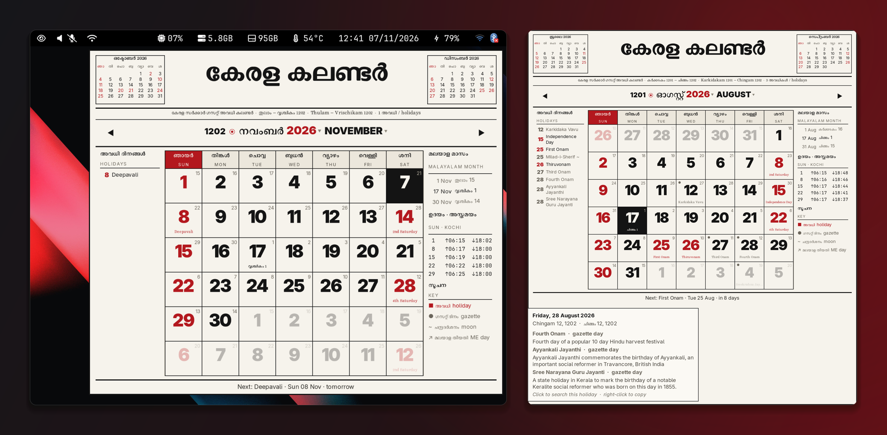
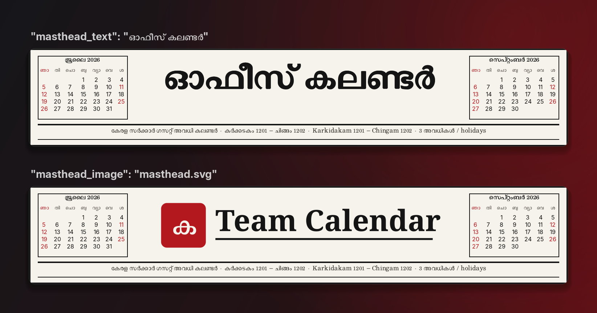

# kcal: Kerala wall calendar for Linux desktops

A paper wall-calendar popup with Kerala government holidays, the Malayalam (Kollavarsham) date for every
day, and sunrise and sunset in Kochi. It opens from a bar click or a key. It is Python and GTK 3, with no
pip packages.

<p align="center">
  
  <br><sub>On Sway under the Waybar clock, and August with a day's hover card. Full size: <a href="screenshots/sway.png">Sway</a>, <a href="screenshots/month.png">month</a>.</sub>
</p>

## Features

- **Kerala gazette holidays** from [officeholidays.com](https://www.officeholidays.com/ics/india/kerala),
  with Google's Indian holidays as the fallback for later years. The data is cached for 7 days and a
  bundled snapshot covers offline first runs.
- **Red days** are Sundays, 2nd and 4th Saturdays, and the holidays you list in `it_set.json`. Other gazette
  days are shown muted.
- **Malayalam date** in each cell, Malayalam month starts, and the month span in the header.
- **Hover card** per day with the holiday's reason. Click a holiday to search for it; right-click a day to
  copy the date.
- **Your own masthead**, as text or an image. No newspaper branding ships with it.
- **Runs on any desktop.** On Sway, Hyprland, river, niri, labwc and KDE Plasma it is a layer-shell overlay
  that closes on an outside click. On X11 (i3, Openbox, XFCE) and on GNOME it is an undecorated window
  that closes when it loses focus.

## Install

```bash
git clone https://github.com/dracu-lah/kerala-calendar.git ~/.local/share/kcal
~/.local/share/kcal/install.sh
```

`install.sh` installs the packages with dnf, pacman or apt, writes `~/.config/kcal/config.json`, and draws
one test frame. Use `--no-deps` to skip the packages. Only Fedora has been tested; the Arch and Debian
package names are untested.

| | Fedora | Arch | Debian / Ubuntu |
| --- | --- | --- | --- |
| GTK + Python | `python3-gobject python3-cairo gtk3` | `python-gobject python-cairo gtk3` | `python3-gi python3-gi-cairo gir1.2-gtk-3.0` |
| Overlay (optional) | `gtk-layer-shell` | `gtk-layer-shell` | `gir1.2-gtklayershell-0.1` |
| Clock + copy | `jq wl-clipboard` | `jq wl-clipboard` | `jq wl-clipboard` |
| Malayalam font | `rit-rachana-fonts` | `noto-fonts` | `fonts-smc-rachana` |

## Open it

The command is `~/.local/share/kcal/kcal.py --toggle`. A second run closes the popup.

**Waybar**: `clock.sh` prints the time with today's holiday in the tooltip:

```json
"custom/clock": {
  "exec": "~/.local/share/kcal/clock.sh",
  "return-type": "json",
  "interval": 30,
  "on-click": "~/.local/share/kcal/kcal.py --toggle"
}
```

**Keys:**

| Desktop | Add |
| --- | --- |
| Sway / i3 | `bindsym $mod+Shift+d exec ~/.local/share/kcal/kcal.py --toggle` |
| Hyprland | `bind = SUPER SHIFT, D, exec, ~/.local/share/kcal/kcal.py --toggle` |
| GNOME | Settings > Keyboard > Custom Shortcuts, command `~/.local/share/kcal/kcal.py --toggle` |
| KDE Plasma | System Settings > Shortcuts > Add New > Command |

Without layer-shell the window has the class `Kcal` (instance and Wayland app_id `kcal`). Add a window rule if your window manager tiles it, for
example in i3: `for_window [class="Kcal"] floating enable`.

In the popup, use **Left, Right, Up and Down** to move a day, **PageUp and PageDown** or the scroll wheel
to change the month, **t** to jump to today, **Enter** to search the selected holiday, and **Esc** to close.

## Configure

`~/.config/kcal/config.json` (or the file in `$KCAL_CONFIG`). Every key is optional:

```json
{
  "masthead_text": "കേരള കലണ്ടർ",
  "masthead_image": "",
  "masthead_height": 88,
  "search_command": [],
  "search_url": "https://www.google.com/search?q={query}"
}
```

| Key | What it does |
| --- | --- |
| `masthead_text` | Title in the masthead. Long titles end with an ellipsis. |
| `masthead_image` | PNG, SVG or JPEG shown instead of the text. A relative path is read from `~/.config/kcal/`. If it fails to load, the text is shown. |
| `masthead_height` | Image height in px (8 to 400). The default, 88, matches the mini months. |
| `search_command` | A browser command for a holiday click, with `{query}` filled in, e.g. `["firefox", "--search", "{query}"]`. If empty, `search_url` opens in your default browser. |
| `search_url` | The search engine URL, with `{query}` filled in. |

<p align="center">
  
  <br><sub>A text masthead, and an image one using the <a href="examples/masthead.svg">example SVG</a>.</sub>
</p>

`--masthead "Title"` and `--masthead-image file.png` override the config for one run.

**Colours and fonts:** `~/.config/kcal/style.css` loads after the built-in [`style.css`](style.css). Copy
any rule you want to change, for example `.mast { font-family: "Manjari"; }`.

**Holidays:** `it_set.json` sets which holidays are red. `holidays-custom.json` adds, renames or removes
days and wins over both feeds.

## Check it

```bash
./kcal.py --screenshot aug.png --month 2026-08 --hover 2026-08-28 --scale 2   # offscreen render
python3 -m pytest -q tests                                                     # date maths, data, config
KCAL_NO_LAYER=1 ./kcal.py --toggle                                             # try the plain-window mode
```

## Files

- **Cache:** `${XDG_CACHE_HOME:-~/.cache}/kcal/`. Delete it to fetch again.
- **Config:** `${XDG_CONFIG_HOME:-~/.config}/kcal/`.

---

Made in [swaydots](https://github.com/dracu-lah/swaydots), where it lives at `.config/waybar/scripts/kcal`.
This repo is that folder with its history. MIT licensed, see [LICENSE](LICENSE).
